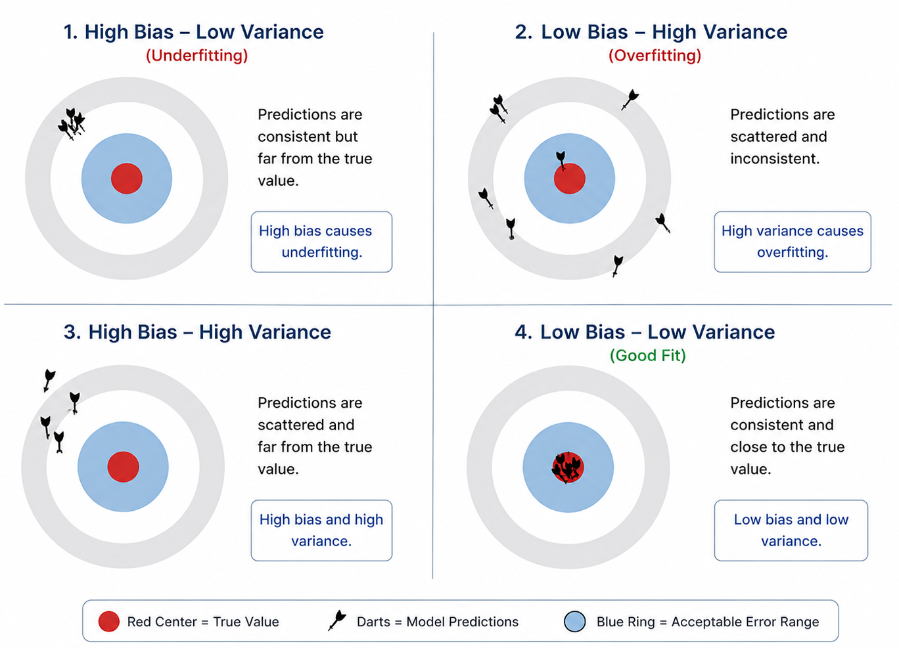
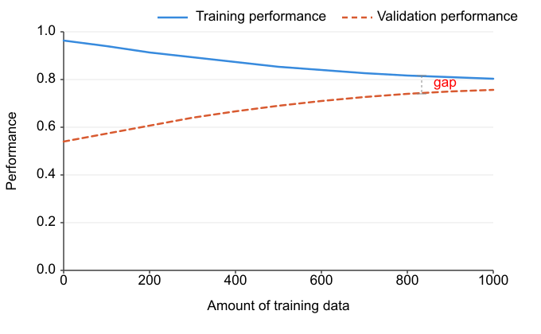
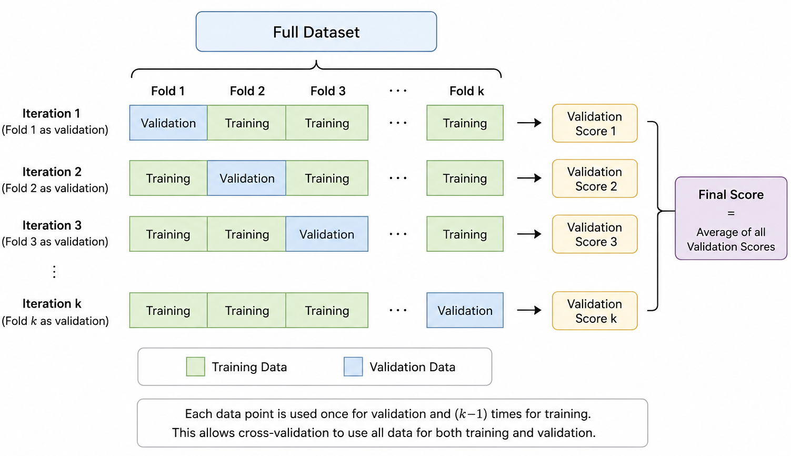

# Machine Learning and Deep Learning Fundamentals

Before exploring machine learning applications in chemical engineering, molecular science, and
materials research, this module introduces the concepts needed to understand and evaluate
data-driven models. It covers the main learning approaches, data preparation, model selection,
validation, and neural network fundamentals. The emphasis is on sound scientific reasoning:
choosing an appropriate method and determining whether its predictions can be trusted.

## Learning Objectives

* Explain the fundamental principles of machine learning
* Differentiate among the main types of learning tasks
* Identify and mitigate overfitting and underfitting
* Apply appropriate validation and model evaluation methods
* Describe the basic structure and function of neural networks
* Understand key strategies for model optimization and hyperparameter tuning
* Recognize common sources of data leakage in molecular and process datasets

## 1. What Is Machine Learning?

### Definition

Machine learning (ML) is a branch of artificial intelligence in which algorithms learn useful
relationships from data. Instead of writing a separate rule for every possible situation,
we use observations to estimate a model that can make predictions or support decisions
for new inputs. Learning requires an explicit objective, suitable data, and an evaluation
procedure. This description is a paraphrase of concepts discussed by Mitchell (1997),
not a quotation from his book.

### Traditional Programming

```text
Rules + Data -> Output
```

### Machine Learning

```text
Training Data + Targets -> Learning Algorithm -> Trained Model
```

### Why Use Machine Learning in Science?

Machine learning helps chemical engineers and materials scientists analyze complex datasets
from experiments, simulations, and industrial processes. It complements mechanistic models
and laboratory measurements in several ways:

* **Estimate properties**, such as solubility, viscosity, and reaction yield, using models
  trained on relevant experimental or computational measurements
* **Identify relationships** among composition, operating conditions, and observed responses
* **Guide molecular and materials design** by prioritizing candidates for further testing
* **Support process optimization** by identifying operating conditions worth investigating
* **Analyze high-dimensional data**, including spectra, molecular descriptors, and sensor signals

### Main Categories of Machine Learning

#### Supervised Learning

Supervised learning uses observations for which both the input features and the target are known.
The algorithm estimates a relationship between them so that it can predict the target for
new observations. Labels may be continuous measurements or discrete categories.

Common supervised learning tasks include:

* **Regression:** predicting numerical values, such as solubility, heat capacity, or reaction yield
* **Classification:** assigning samples to categories, such as toxic versus non-toxic compounds
  or acceptable versus off-specification process batches

In supervised learning, a model often minimizes an average loss over $n$ observations:

$$
\mathcal{L}(\theta) = \frac{1}{n}\sum_{i=1}^{n}
\ell\left(f_{\theta}(\mathbf{x}_i), y_i\right),
$$

where $\mathbf{x}_i$ contains the input features, $y_i$ is the known target,
$f_{\theta}$ is the prediction model, and $\ell$ measures prediction error.

??? note "Example"

    ```python
    # Illustration: a linear regression model using fabricated solubility data.
    # The small dataset demonstrates the workflow, not predictive accuracy.
    import numpy as np
    from sklearn.model_selection import train_test_split
    from sklearn.linear_model import LinearRegression
    from sklearn.metrics import mean_squared_error

    # Columns: molecular weight, polar surface area, and estimated logP.
    X = np.array([
        [180.1, 45.2, 1.2],
        [250.3, 60.1, 2.5],
        [320.5, 75.0, 3.8],
        [150.2, 30.5, 0.8],
        [275.4, 68.2, 2.9],
        [210.0, 50.0, 1.7]])

    # Invented target values in arbitrary units, for teaching only.
    y = np.array([12.5, 8.1, 3.2, 15.0, 6.4, 10.2])

    # Split dataset into training and testing sets
    X_train, X_test, y_train, y_test = train_test_split(
        X, y, test_size=0.2, random_state=42
    )

    # Create and train the model
    model = LinearRegression()
    model.fit(X_train, y_train)

    # Evaluate the model
    y_pred = model.predict(X_test)
    mse = mean_squared_error(y_test, y_pred)
    print(f"Test MSE (illustrative only): {mse:.3f}")

    # Predict the target for a hypothetical molecule with the same descriptors.
    new_molecule = np.array([[240.0, 55.0, 2.1]])
    prediction = model.predict(new_molecule)
    print("Predicted solubility:", prediction[0])
    ```

#### Unsupervised Learning

Unsupervised learning analyzes input data without labeled target outcomes. Its purpose is to
identify patterns, group similar observations, or construct simpler representations that
help researchers explore a dataset.

Common unsupervised learning techniques include:

* **Clustering:** grouping materials or molecules with similar measured properties or features
* **Dimensionality reduction:** representing high-dimensional data with fewer variables
  for visualization, compression, or exploratory analysis
* **Anomaly detection:** identifying samples that differ noticeably from typical observations

K-means is a common clustering algorithm. It partitions samples into $K$ groups by
minimizing the sum of squared Euclidean distances to their assigned cluster centroids:

$$
J = \sum_{k=1}^{K}\sum_{\mathbf{x}_i\in C_k}
\left\|\mathbf{x}_i-\boldsymbol{\mu}_k\right\|_2^2,
$$

where $\boldsymbol{\mu}_k$ is the centroid of cluster $C_k$. The number of clusters $K$
must be specified in advance; a low objective value does not automatically mean the
groups are chemically meaningful. K-means uses Euclidean distance, so feature scaling
and the molecular representation strongly affect the result. For binary molecular
fingerprints, Tanimoto-based methods may better match the intended similarity notion.

??? note "Example"

    ```python
    # Illustration: K-means on five invented binary molecular descriptors.
    import numpy as np
    from sklearn.cluster import KMeans
    from sklearn.decomposition import PCA
    import matplotlib.pyplot as plt

    # Rows are hypothetical molecules; columns indicate feature presence (0/1).
    # These are not RDKit fingerprints or measured molecular descriptors.
    # Molecular features:
    # 0 = aromatic ring
    # 1 = nitrogen atom
    # 2 = hydroxyl group
    # 3 = carbonyl group
    # 4 = halogen atom
    molecular_fingerprints = np.array([
        [1, 0, 1, 0, 1],
        [1, 0, 1, 0, 0],
        [0, 1, 0, 1, 1],
        [0, 1, 0, 1, 0],
        [1, 1, 0, 0, 1],
        [1, 1, 0, 0, 0],
        [0, 0, 1, 1, 1],
        [0, 0, 1, 1, 0]])

    # Create the K-Means clustering model
    kmeans = KMeans(n_clusters=3, random_state=42, n_init=10)

    # Assign each molecule to a cluster
    clusters = kmeans.fit_predict(molecular_fingerprints)

    # Display clustering results
    for i, cluster_id in enumerate(clusters):
        print(f"Molecule {i + 1} belongs to Cluster {cluster_id}")

    # Show a 2D PCA projection; clustering was performed in all five dimensions.
    X_2d = PCA(n_components=2).fit_transform(molecular_fingerprints)
    plt.figure(figsize=(6, 5))
    plt.scatter(X_2d[:, 0], X_2d[:, 1], c=clusters, s=100, cmap="tab10")
    plt.xlabel("Principal Component 1")
    plt.ylabel("Principal Component 2")
    plt.title("K-means Clusters (PCA Visualization)")
    plt.savefig("clustering.png", dpi=300, bbox_inches="tight")
    plt.show()
    ```

#### Reinforcement Learning

Reinforcement learning studies how an agent chooses actions while interacting with an
environment. The agent observes the consequences of its actions and improves a policy to
maximize expected cumulative reward. Unlike ordinary supervised learning, correct actions
are not necessarily provided as labels for every state.

An agent may seek to maximize a discounted return of the form

$$
G_t = \sum_{k=0}^{\infty}\gamma^k r_{t+k+1},
$$

where $r_{t+k+1}$ is the reward received after a future action and
$0 \leq \gamma < 1$ determines how strongly future rewards are weighted.

In molecular and materials science, reinforcement learning can support applications such as:

* **Molecular optimization:** proposing structural modifications that improve target properties
* **Synthesis planning:** selecting reaction steps that lead to a desired compound
* **Process control:** learning sequential control decisions under operational constraints

## 2. The Machine Learning Workflow

### Defining the Machine Learning Problem

A reliable ML project begins with a scientific question and a clear definition of success.
Before choosing an algorithm, identify the available inputs, the outcome of interest,
the intended use of the predictions, and the consequences of different errors.

A typical workflow includes:

1. **State the objective:** identify the property, process variable, or scientific relationship
   that the model should predict or investigate.
2. **Select the learning task:** decide whether regression, classification, clustering,
   generative modeling, or another approach best addresses the objective.
3. **Define success:** choose evaluation metrics, a baseline, and practical performance
   requirements before examining the final test results.

Example:

> Build a binary classifier for blood–brain barrier permeability with at least 85% balanced
> accuracy on a held-out scaffold-based test set, and report sensitivity and specificity.

For chemical engineering, an alternative is to predict reactor conversion from feed
composition, temperature, and residence time within a specified operating range.

### Data Collection and Preparation

The accuracy and usefulness of an ML model depend on the relevance and reliability of its data.
Measurements should be checked for inconsistent units, missing values, duplicate observations,
uncertain labels, and differences in experimental conditions. The dataset should also represent
the chemical compositions or operating conditions where the model will be applied.

#### Data Sources

Scientific data can be collected from a variety of sources, such as:

* **Experimental data**, obtained from laboratory measurements, pilot plants, and process sensors
* **Simulation data**, produced by density functional theory (DFT), molecular dynamics (MD),
  or process simulation software
* **Public databases**, such as PubChem, ChEMBL, and the Materials Project

#### Data Quality Checks

**pandas** is a Python library for organizing, exploring, and transforming structured datasets.
Its central data structure, the DataFrame, provides a convenient way to work with tabular information.
In scientific workflows, pandas is often used to import data, handle missing entries,
select or filter observations, calculate summary statistics, and prepare datasets for modeling.

**RDKit** is an open-source cheminformatics toolkit for processing molecular structures.
It can parse SMILES strings, calculate molecular descriptors and fingerprints, visualize
chemical structures, and support molecular similarity analysis. A molecular descriptor
is a numerical property, such as molecular weight or topological polar surface area,
that can serve as an ML input feature.

??? note "Example"

    ```python
    # Example: clean a small table, validate SMILES, and calculate descriptors.
    # This is exploratory cleaning; production thresholds require domain checks.
    import pandas as pd
    import numpy as np
    from rdkit import Chem
    from rdkit.Chem import Descriptors

    # 1. Create a small example dataset
    data = pd.DataFrame({
        "molecule_name": [
            "Ethanol", "Acetic acid", "Benzene", "Acetone", "Phenol",
            "Ethanol", "Invalid molecule", "Large outlier"
        ],
        "smiles": [
            "CCO", "CC(=O)O", "c1ccccc1", "CC(=O)C", "c1ccccc1O",
            "CCO", "not_a_smiles", "CCCCCCCCCCCCCCCC"
        ],
        "property": [
            -0.31, -0.17, -2.13, -0.24, -1.46,
            -0.31, np.nan, 50.0  # Artificial extreme value
        ]
    })

    # Save dataset as CSV
    data.to_csv("molecular_data.csv", index=False)

    # 2. Load data
    data = pd.read_csv("molecular_data.csv")

    print("Original data:")
    print(data)

    # 3. Check for missing values
    print("\nMissing values:")
    print(data.isnull().sum())

    # 4. Check for duplicates
    print("\nNumber of duplicate rows:")
    print(data.duplicated().sum())

    # Remove duplicate rows
    data = data.drop_duplicates(subset=["smiles", "property"])

    # 5. Check distributions
    print("\nSummary statistics:")
    print(data.describe())

    # 6. Remove missing targets and invalid molecular structures.
    data = data.dropna(subset=["smiles", "property"])
    data = data.loc[
        data["smiles"].map(lambda s: Chem.MolFromSmiles(s) is not None)
    ].copy()

    # 7. Flag extreme targets using the interquartile range (IQR).
    # Do not automatically discard scientifically valid extreme measurements.
    q1, q3 = data["property"].quantile([0.25, 0.75])
    iqr = q3 - q1
    lower, upper = q1 - 1.5 * iqr, q3 + 1.5 * iqr
    data["possible_outlier"] = ~data["property"].between(lower, upper)
    print("\nPotential outliers:")
    print(data.loc[data["possible_outlier"]])

    # Use the non-outlier subset solely to illustrate a cleaning decision.
    data_clean = data.loc[~data["possible_outlier"]].copy()
    print("\nCleaned data:")
    print(data_clean)

    # 8. Feature engineering with RDKit

    def calculate_features(smiles):
        """
        Convert a molecule represented by a SMILES string
        into numerical molecular descriptors.
        """

        mol = Chem.MolFromSmiles(smiles)

        # Handle invalid molecules
        if mol is None:
            return None

        features = {
            "molecular_weight": Descriptors.MolWt(mol),
            "logP": Descriptors.MolLogP(mol),
            "num_h_donors": Descriptors.NumHDonors(mol),
            "num_h_acceptors": Descriptors.NumHAcceptors(mol),
            "tpsa": Descriptors.TPSA(mol),
            "num_rotatable_bonds": Descriptors.NumRotatableBonds(mol),
            "num_aromatic_rings": Descriptors.NumAromaticRings(mol)
        }

        return features

    # 9. Apply feature engineering to each molecule
    feature_rows = []

    for _, row in data_clean.iterrows():
        features = calculate_features(row["smiles"])

        if features is not None:
            features["molecule_name"] = row["molecule_name"]
            features["smiles"] = row["smiles"]
            features["property"] = row["property"]
            feature_rows.append(features)

    features_df = pd.DataFrame(feature_rows)

    # Reorder columns
    features_df = features_df[[
        "molecule_name", "smiles", "molecular_weight", "logP",
        "num_h_donors", "num_h_acceptors", "tpsa",
        "num_rotatable_bonds", "num_aromatic_rings", "property"
    ]]
    print("\nFinal feature table:")
    print(features_df)

    # 10. Save final processed dataset
    features_df.to_csv("molecular_features.csv", index=False)
    print("\nProcessed dataset saved as molecular_features.csv")
    ```

This example identifies possible outliers but does not establish that they are erroneous.
If outlier handling or imputation uses estimated statistics, calculate those statistics
from the training data only after splitting, ideally within a scikit-learn pipeline.

### Training, Validation, and Test Sets

An ML model should be assessed on observations that did not influence its parameter fitting
or model selection. Otherwise, the reported performance may be overly optimistic.

> **Critical principle:** Keep the final test set separate from training, preprocessing
> decisions, and hyperparameter selection.

Evaluating only on training observations measures how well a model fits known examples;
it does not establish how well predictions generalize. A validation set supports model
development, while a test set provides a final, independent estimate.

To reduce this risk, datasets are commonly separated into three subsets:

#### Training Set

The **training set** is used to fit the model parameters and learn patterns from the available data.

#### Validation Set

The **validation set** is used to tune hyperparameters, compare approaches, and select
the training epoch. Alternatively, cross-validation can serve this purpose.

#### Test Set

The **test set** is reserved for a final evaluation after model development is complete.

#### Typical Dataset Split

| Dataset        | Typical Fraction |
| -------------- | ---------------- |
| Training Set   | 70%              |
| Validation Set | 15%              |
| Test Set       | 15%              |

This is one illustrative allocation, not a universal rule. For small datasets,
cross-validation may be more useful; for time-dependent or related samples,
the splitting strategy matters more than the exact percentages.

#### Conceptual Workflow

```text
Training Set   -> Fit the model
Validation Set -> Tune and compare models
Test Set       -> Evaluate final performance
```

??? note "Example"

    ```python
    # Example: a 70% / 15% / 15% split of ten illustrative observations.

    import numpy as np
    from sklearn.model_selection import train_test_split

    # 1. Create a small example dataset
    # X = input features
    # y = target values

    X = np.array([
        [1.0, 2.0],
        [2.0, 1.5],
        [3.0, 3.5],
        [4.0, 4.5],
        [5.0, 5.5],
        [6.0, 6.5],
        [7.0, 7.5],
        [8.0, 8.5],
        [9.0, 9.5],
        [10.0, 10.5]
    ])

    y = np.array([1, 1, 2, 2, 3, 3, 4, 4, 5, 5])

    # 2. First split: training set and temporary set
    X_train, X_temp, y_train, y_temp = train_test_split(
        X, y, test_size=0.30, random_state=42
    )

    # 3. Second split: validation set and test set
    X_val, X_test, y_val, y_test = train_test_split(
        X_temp, y_temp, test_size=0.50, random_state=42
    )

    # 4. Print the results
    print("Training set:")
    print("X_train:")
    print(X_train)
    print("y_train:")
    print(y_train)

    print("\nValidation set:")
    print("X_val:")
    print(X_val)
    print("y_val:")
    print(y_val)

    print("\nTest set:")
    print("X_test:")
    print(X_test)
    print("y_test:")
    print(y_test)

    # 5. Print the sizes
    print("\nDataset sizes:")
    print("Training set size:", len(X_train))
    print("Validation set size:", len(X_val))
    print("Test set size:", len(X_test))
    ```

### Scaffold-Based Splitting

In molecular machine learning, **scaffold-based splitting** separates molecules according
to their underlying structural frameworks rather than assigning individual compounds randomly
to training, validation, and test sets.

A molecular scaffold represents the main structural backbone of a molecule, commonly defined by
its ring systems and the linkers that connect them after peripheral substituents are removed.
Molecules sharing the same scaffold often exhibit substantial structural similarity and may also
display related chemical or biological properties.

This creates a potential problem with random splitting. Molecules based on the same scaffold can
appear in both the training and test sets, meaning that the model may already have encountered very
similar structural patterns during training. As a result, test performance can appear better than the
model's true ability to generalize to unfamiliar regions of chemical space.

Scaffold-based splitting keeps molecules with the same scaffold in one subset. A scaffold-held-out
test set therefore evaluates transfer to new structural cores. Scaffold overlap between random
splits is not automatically *data leakage*, but it can make the evaluation easier than the
intended task of predicting properties for novel chemical frameworks.

#### Conceptual Example

```text
Random Split:
  Train -> Toluene   (benzene Murcko scaffold)
  Test  -> Phenol    (benzene Murcko scaffold)

  The training and test compounds contain closely related
  structural frameworks, making the prediction task easier.
```

```text
Scaffold Split:
  Train -> Toluene   (benzene Murcko scaffold)
  Test  -> Pyridine  (pyridine Murcko scaffold)

  The test molecule belongs to a structurally different
  scaffold family that was not represented during training.
```

Scaffold-based splitting is commonly used in molecular property prediction and drug discovery when
the objective is to evaluate whether a model can make reliable predictions for compounds with
previously unseen structural cores.

??? note "Example"

    ```python
    import numpy as np

    from rdkit import Chem
    from rdkit.Chem.Scaffolds import MurckoScaffold
    from sklearn.model_selection import GroupShuffleSplit

    # 1. Example molecules
    molecules = [
        # Benzene scaffold
        "Cc1ccccc1",        # Toluene
        "Oc1ccccc1",        # Phenol
        "Nc1ccccc1",        # Aniline

        # Pyridine scaffold
        "c1ccncc1",         # Pyridine
        "CCc1ccncc1",       # Ethylpyridine
        "Oc1ccncc1",        # Hydroxypyridine

        # Cyclohexane scaffold
        "C1CCCCC1",         # Cyclohexane
        "CC1CCCCC1",        # Methylcyclohexane
        "OC1CCCCC1",        # Cyclohexanol

        # Thiophene scaffold
        "c1ccsc1",          # Thiophene
        "Cc1ccsc1",         # Methylthiophene
        "Oc1ccsc1"          # Hydroxythiophene
    ]

    # Example target property
    y = np.array([1.2, 1.4, 1.1, 0.8, 0.9, 0.7,
                  1.7, 1.6, 1.8, 0.5, 0.6, 0.4])

    # 2. Generate simple molecular features
    X = []

    for smiles in molecules:

        mol = Chem.MolFromSmiles(smiles)

        if mol is None:
            raise ValueError(f"Invalid SMILES: {smiles}")
        features = [
            mol.GetNumAtoms(), mol.GetNumBonds(), mol.GetRingInfo().NumRings()
        ]

        X.append(features)

    X = np.array(X)

    # 3. Extract Murcko scaffolds
    def get_scaffold(smiles):

        mol = Chem.MolFromSmiles(smiles)

        if mol is None:
            raise ValueError(f"Invalid SMILES: {smiles}")
        return MurckoScaffold.MurckoScaffoldSmiles(mol=mol)

    scaffolds = np.array([get_scaffold(smiles) for smiles in molecules])

    print("Molecular scaffolds:\n")

    for smiles, scaffold in zip(molecules, scaffolds):
        print(f"{smiles:20s} -> {scaffold}")

    # 4. Scaffold-based train/test split
    # test_size refers to the fraction of scaffold groups, not the number
    # of molecules; actual sample fractions may differ for unequal groups.
    splitter = GroupShuffleSplit(
        n_splits=1, test_size=0.25, random_state=42
    )

    train_idx, test_idx = next(
        splitter.split(X, y, groups=scaffolds)
    )

    # 5. Create training and test sets
    X_train = X[train_idx]
    X_test = X[test_idx]

    y_train = y[train_idx]
    y_test = y[test_idx]

    # 6. Display the split
    print("\nTraining set:")

    for i in train_idx:
        print(molecules[i], " scaffold:", scaffolds[i])

    print("\nTest set:")

    for i in test_idx:
        print(molecules[i], " scaffold:", scaffolds[i])

    # 7. Verify scaffold separation
    train_scaffolds = set(scaffolds[train_idx])

    test_scaffolds = set(scaffolds[test_idx])

    print("\nTraining scaffolds:")
    print(train_scaffolds)

    print("\nTest scaffolds:")
    print(test_scaffolds)

    shared = train_scaffolds.intersection(test_scaffolds)
    print("\nShared scaffolds:", shared)
    assert not shared, "The train and test sets share a scaffold."
    ```

Bemis–Murcko scaffolds retain ring systems and their linkers, so many acyclic
molecules have an empty scaffold. For such datasets, consider a different
grouping strategy. Scaffolds determine *which samples go into each split*;
they are not automatically features supplied to the model.

### Baselines and Domain of Applicability

Before training a complex model, establish a reference prediction. For regression,
a common baseline is the training-set mean; for classification, it might be the
most frequent class. A model that cannot improve on a suitable baseline may not
be learning a useful relationship. Always compute baseline statistics from the
training data, not from the final test targets.

Scientific models are also limited by the conditions represented in their training
data. A reactor conversion model trained at moderate temperatures may extrapolate
poorly to higher temperatures; a molecular model trained on one structural family
may fail on unfamiliar scaffolds. State the model's intended domain of application
and investigate uncertainty or extrapolation risk before using predictions to
guide expensive experiments or safety-critical decisions.

## 3. Overfitting and Underfitting

### The Bias-Variance Tradeoff

**Underfitting (often associated with high bias):**

* The model is not flexible enough to capture the complexity present in the data
* Produces poor results on both the training set and previously unseen data
* Misses important trends, dependencies, and relevant structure
* Often arises when the model is too simple or the available features are not sufficiently informative

**Overfitting (often associated with high variance):**

* The model is overly flexible compared with the amount and diversity of available training data
* Performs extremely well on the training set but generalizes poorly to new samples
* Fits noise and dataset-specific fluctuations instead of learning robust patterns
* Commonly leads to unreliable predictions on unseen data

**Appropriate model complexity:**

* The model is expressive enough to capture important trends without excessive flexibility
* Achieves strong performance on both training and test data
* Learns meaningful relationships while avoiding excessive sensitivity to noise
* Generalizes well to new examples that were not used during training

{: style="width: 600px;"}

Bias is the systematic error introduced by model assumptions; variance measures
how sensitive a fitted model is to the training sample. Model complexity often
changes both, but underfitting and overfitting are not exact synonyms for bias
and variance. Their balance is assessed using held-out predictions.

??? note "Example"

    ```python
    # Underfitting vs Good Fit vs Overfitting
    import numpy as np
    import matplotlib.pyplot as plt

    # Reproducibility
    np.random.seed(42)

    # 1. Generate synthetic dataset
    # Input variable
    X = np.linspace(0, 10, 50)

    # True underlying relationship. Quadratic function + random noise
    y = 0.5 * X**2 - 2 * X + 3 + np.random.normal(0, 4, 50)

    # 2. Train polynomial models
    # Underfitting model: Degree 1 polynomial (linear model)
    underfit_model = np.poly1d(np.polyfit(X, y, 1))

    # Good fit model: Degree 2 polynomial (matches true relationship)
    good_model = np.poly1d(np.polyfit(X, y, 2))

    # Overfitting model: Very high-degree polynomial
    overfit_model = np.poly1d(np.polyfit(X, y, 15))

    # 3. Create smooth plotting grid
    X_plot = np.linspace(0, 10, 500)

    # 4. Visualize results
    plt.figure(figsize=(10, 6))

    # Original data points
    plt.scatter(X, y, alpha=0.7, label="Training Data")

    # Underfitting curve
    plt.plot(
        X_plot, underfit_model(X_plot), linestyle="--", linewidth=2,
        label="Underfitting (degree 1)"
    )

    # Good fit curve
    plt.plot(X_plot, good_model(X_plot), linewidth=2, label="Good fit (degree 2)")

    # Overfitting curve
    plt.plot(
        X_plot, overfit_model(X_plot), linestyle=":", linewidth=2,
        label="High complexity (degree 15)"
    )

    # 5. Labels and formatting
    plt.xlabel("Input Feature")
    plt.ylabel("Target Value")
    plt.title("Underfitting vs Good Fit vs Overfitting")
    plt.legend()
    plt.grid(True)
    plt.savefig("underfitting-overfitting.png", dpi=300, bbox_inches="tight")
    plt.show()
    ```

### Detecting Overfitting

One useful diagnostic is a **learning curve**, which compares performance on training
and validation data as the amount of training data increases. Curves plotted against
training epochs are also common, but they answer a different question: how performance
changes as optimization proceeds.

Typically, two curves are monitored:

* **Training performance**
* **Validation performance**

{: style="width: 600px;"}

### Interpreting Learning Curves

#### Overfitting

Overfitting is suggested by a persistent gap between strong training performance and
weaker validation performance. For error-based curves, the training error is much lower
than the validation error. The gap often shrinks when more representative data are added.

#### Underfitting

Underfitting is suggested when both training and validation errors remain high.
This may reflect insufficient model flexibility, uninformative features, excessive
regularization, or incomplete optimization.

#### Good Generalization

A model that generalizes well has suitably low validation error and a moderate
training-validation gap. The relevant error threshold depends on the application;
a small gap alone is not sufficient if both errors are large.

```text
Overfitting:
Training accuracy   -> Very high
Validation accuracy -> Clearly lower

Underfitting:
Training accuracy   -> Low
Validation accuracy -> Low

Good generalization:
Training accuracy   -> High
Validation accuracy -> High and close to training
```

??? note "Example"

    ```python
    # Example: learning curves for a deliberately high-capacity polynomial model.
    import numpy as np
    import matplotlib.pyplot as plt

    from sklearn.model_selection import learning_curve, KFold
    from sklearn.preprocessing import PolynomialFeatures
    from sklearn.pipeline import make_pipeline
    from sklearn.linear_model import LinearRegression

    # 1. Generate synthetic regression data
    np.random.seed(42)

    X = np.linspace(0, 10, 100).reshape(-1, 1)

    # True relationship is quadratic
    y = 0.5 * X[:, 0]**2 - 2 * X[:, 0] + 3
    y += np.random.normal(0, 4, 100)

    # 2. Define an intentionally complex model
    model = make_pipeline(PolynomialFeatures(degree=10), LinearRegression())

    # 3. Define cross-validation
    cv = KFold(n_splits=5, shuffle=True, random_state=42)

    # 4. Compute learning curves
    train_sizes, train_scores, val_scores = learning_curve(
        model, X, y, train_sizes=np.linspace(0.2, 1.0, 9), cv=cv,
        scoring="neg_mean_squared_error", shuffle=True, random_state=42
    )

    # 5. Convert negative MSE into positive MSE
    train_errors = -train_scores.mean(axis=1)
    val_errors = -val_scores.mean(axis=1)

    train_std = train_scores.std(axis=1)
    val_std = val_scores.std(axis=1)

    # 6. Plot learning curves
    plt.figure(figsize=(10, 6))

    plt.plot(train_sizes, train_errors, marker="o", label="Training MSE")

    plt.plot(train_sizes, val_errors, marker="o", label="Validation MSE")

    plt.fill_between(
        train_sizes, train_errors - train_std,
        train_errors + train_std, alpha=0.2
    )

    plt.fill_between(
        train_sizes, val_errors - val_std,
        val_errors + val_std, alpha=0.2
    )

    plt.xlabel("Training Set Size")
    plt.ylabel("Mean Squared Error")
    plt.title("Learning Curves")
    plt.legend()
    plt.grid(True)
    plt.savefig("learning-curves.png", dpi=300, bbox_inches="tight")
    plt.show()

    # 7. Print numerical results
    print("Training set sizes:")
    print(train_sizes)
    print("\nTraining errors:")
    print(train_errors)
    print("\nValidation errors:")
    print(val_errors)
    ```

### Preventing Overfitting

#### 1. Get More Data

Additional *independent* observations can improve generalization when the current
dataset is too small. Molecular data augmentation sometimes helps, but multiple
SMILES strings for the same molecule are not new independent measurements.

```python
# Demonstration: generate alternative SMILES representations of one molecule.
from rdkit import Chem

def augment_molecule(smiles):
    mol = Chem.MolFromSmiles(smiles)
    if mol is None:
        raise ValueError(f"Invalid SMILES: {smiles}")

    # Generate different SMILES representations
    augmented = []
    for _ in range(5):
        random_smiles = Chem.MolToSmiles(mol, doRandom=True)
        augmented.append(random_smiles)

    return sorted(set(augmented))


print(augment_molecule("CC(=O)O"))
```

This augmentation is mainly relevant to sequence models trained on SMILES. For
descriptor or fingerprint models, equivalent SMILES commonly produce the same
features. Keep all representations of a molecule in the *same data split*.

#### 2. Regularization
Regularization discourages a model from relying excessively on large or numerous
fitted parameters. Common penalties include L1, L2, and their combination.

**L1 Regularization (Lasso)**: Encourages sparsity by penalizing the absolute values of
model parameters. In linear models, some coefficients may become exactly zero,
which can act as a form of feature selection.

$$
\mathcal{L}(\mathbf{w}) = \mathcal{L}_{\mathrm{data}}(\mathbf{w})
+ \lambda_1 \sum_{j=1}^{p} |w_j|
$$

Here:

* $\mathcal{L}_{\mathrm{data}}$ is the prediction loss
* $w_j$ are the $p$ penalized coefficients, usually excluding the intercept
* $\lambda_1$ controls L1 regularization strength

```python
from sklearn.datasets import make_regression
from sklearn.linear_model import Lasso
from sklearn.pipeline import make_pipeline
from sklearn.preprocessing import StandardScaler

X_train, y_train = make_regression(
    n_samples=100, n_features=8, noise=10, random_state=42
)
model = make_pipeline(StandardScaler(), Lasso(alpha=0.1))
model.fit(X_train, y_train)
```

**L2 Regularization (Ridge)**: Penalizes large model parameters by adding the squared magnitude of
the weights to the loss function. This helps reduce model complexity and improves generalization.

$$
\mathcal{L}(\mathbf{w}) = \mathcal{L}_{\mathrm{data}}(\mathbf{w})
+ \lambda_2 \sum_{j=1}^{p} w_j^2
$$

Here:

* $\mathcal{L}_{\mathrm{data}}$ is the prediction loss
* $w_j$ are the penalized coefficients
* $\lambda_2$ controls L2 regularization strength

```python
from sklearn.datasets import make_regression
from sklearn.linear_model import Ridge
from sklearn.pipeline import make_pipeline
from sklearn.preprocessing import StandardScaler

X_train, y_train = make_regression(
    n_samples=100, n_features=8, noise=10, random_state=42
)
model = make_pipeline(StandardScaler(), Ridge(alpha=1.0))
model.fit(X_train, y_train)
```

**Elastic Net**: Combines both L1 and L2 regularization, encouraging sparsity while also
penalizing large model parameters.

$$
\mathcal{L}(\mathbf{w}) = \mathcal{L}_{\mathrm{data}}(\mathbf{w})
+ \lambda_1 \sum_{j=1}^{p} |w_j|
+ \lambda_2 \sum_{j=1}^{p} w_j^2
$$

Here:

* $\mathcal{L}_{\mathrm{data}}$ is the prediction loss
* $w_j$ are the penalized coefficients
* $\lambda_1$ controls the strength of the L1 penalty
* $\lambda_2$ controls the strength of the L2 penalty

```python
from sklearn.datasets import make_regression
from sklearn.linear_model import ElasticNet
from sklearn.pipeline import make_pipeline
from sklearn.preprocessing import StandardScaler

X_train, y_train = make_regression(
    n_samples=100, n_features=8, noise=10, random_state=42
)
model = make_pipeline(StandardScaler(), ElasticNet(alpha=0.1, l1_ratio=0.5))
model.fit(X_train, y_train)
```

These expressions are conceptual; scikit-learn estimators use their own
conventions for scaling the data loss and regularization terms. Standardizing
continuous input features is often useful because coefficient penalties are
sensitive to feature scale. Fit the scaler only on training data, as shown.

#### 3. Cross-Validation

Cross-validation is a widely used technique for evaluating machine learning models more reliably,
especially when the available dataset is limited. Instead of performing a single train-test split,
the data is divided into multiple subsets, allowing the model to be trained and validated several
times on different portions of the dataset. See below for more details on cross-validation.

#### 4. Feature Selection

Feature selection retains variables that carry useful predictive information and removes
variables that are irrelevant or redundant. Reducing input dimensionality can lower
computational cost, improve interpretability, and sometimes reduce overfitting.
It is particularly helpful for high-dimensional molecular and materials datasets,
whose descriptors may be strongly correlated. Feature selection must be fitted
inside each training fold to avoid data leakage.

??? note "Example"

    ```python
    # Example: univariate feature selection fitted only on training data.

    import pandas as pd

    from sklearn.datasets import make_regression
    from sklearn.model_selection import train_test_split
    from sklearn.feature_selection import SelectKBest, f_regression

    # 1. Generate a synthetic regression dataset
    X, y = make_regression(
        n_samples=100, n_features=20, n_informative=8,
        noise=10, random_state=42
    )

    # 2. Create a DataFrame with feature names
    feature_names = [f"feature_{i}" for i in range(20)]

    X = pd.DataFrame(X, columns=feature_names)

    # 3. Split the dataset into training and test sets
    X_train, X_test, y_train, y_test = train_test_split(
        X, y, test_size=0.2, random_state=42
    )

    # 4. Select the top 8 features
    # Eight features contributed to the synthetic target, but an
    # individual univariate test may not recover exactly those eight.
    selector = SelectKBest(score_func=f_regression, k=8)

    # Fit the selector only on the training data
    X_train_selected = selector.fit_transform(X_train, y_train)

    # Apply the same feature selection to the test set
    X_test_selected = selector.transform(X_test)

    # 5. Display feature scores
    feature_scores = pd.DataFrame({
        "Feature": X.columns,
        "F-score": selector.scores_,
        "Selected": selector.get_support()
    })

    feature_scores = feature_scores.sort_values(by="F-score", ascending=False)

    print("Feature scores:\n")
    print(feature_scores)

    # 6. Display selected feature names
    selected_features = X.columns[selector.get_support()]

    print("\nSelected features:")
    print(selected_features.tolist())

    # 7. Display dataset shapes
    print("\nOriginal training shape:")
    print(X_train.shape)

    print("\nReduced training shape:")
    print(X_train_selected.shape)

    print("\nOriginal test shape:")
    print(X_test.shape)

    print("\nReduced test shape:")
    print(X_test_selected.shape)
    ```

#### 5. Early Stopping (for Neural Networks)

Early stopping is a regularization strategy that helps prevent overfitting during neural network
training. Although the training loss often continues to decrease, validation performance may
eventually stop improving or begin to worsen. Early stopping tracks a validation metric and
terminates training when no meaningful improvement occurs for a predefined number of epochs.
The model with the best observed validation score should be restored, rather than
retaining the weights from the final epoch. Patience is a tuning choice.

#### 6. Dropout (for Neural Networks)

Dropout is a regularization method designed to improve the generalization of neural networks.
During training, a proportion of neuron activations is randomly set to zero at each iteration.
This prevents the network from depending too strongly on particular neurons or pathways and
encourages more distributed feature representations. During validation and prediction, dropout
is disabled and activations are handled deterministically.

### Addressing Underfitting

1. **Increase model capacity:** use a more flexible model, add hidden units, or increase network depth
2. **Reduce regularization:** decrease the strength of penalties such as L1, L2, or dropout
3. **Improve the input features:** use domain knowledge to select informative
   variables or construct better molecular and process representations
4. **Train for more iterations:** increase the number of epochs if the model has not yet converged
5. **Review the data pipeline:** check labels, preprocessing, scaling, and
   feature construction for errors

## 4. Cross-Validation

### Why Cross-Validation?

Cross-validation estimates how a modeling procedure performs across several training and
validation partitions. Compared with a single split, it reveals how sensitive the score
is to the selected observations and uses limited data efficiently. The results are still
dependent on the representativeness of the dataset and the splitting strategy.

Use cross-validation for model selection on the development data, then evaluate the
chosen model once on an untouched test set. Any learned preprocessing step, such as
scaling or feature selection, must be fitted independently inside each training fold.

### K-Fold Cross-Validation

In $K$-fold cross-validation, the development data are divided into $K$ approximately
equal folds. The model is fitted $K$ times, each time using $K-1$ folds for training and
the remaining fold for validation. Report the mean and variability of the $K$ scores.
These are *validation* folds, not separate final test sets.

{: style="width: 600px;"}

??? note "Example"

    ```python
    # Example: five-fold cross-validation on synthetic regression data.

    from sklearn.datasets import make_regression
    from sklearn.linear_model import LinearRegression
    from sklearn.model_selection import KFold, cross_val_score

    # 1. Generate example regression dataset
    X, y = make_regression(
        n_samples=100, n_features=3, noise=15, random_state=42
    )

    # 2. Define machine learning model
    model = LinearRegression()

    # 3. Perform 5-fold cross-validation
    cv = KFold(n_splits=5, shuffle=True, random_state=42)
    scores = cross_val_score(model, X, y, cv=cv, scoring="r2")

    # 4. Display results
    print("R² score for each fold:")
    print(scores)
    print("\nAverage cross-validation performance:")
    print(f"Cross-validation R²: {scores.mean():.3f} ± {scores.std():.3f}")
    ```

    The code:

    * generates a synthetic regression dataset,
    * trains a linear regression model,
    * evaluates it using 5-fold cross-validation,
    * reports the mean and standard deviation of the $R^2$ score across the folds.

### Stratified K-Fold

Stratified $K$-fold cross-validation aims to preserve approximately the same class
proportions in every fold. It is helpful when class frequencies differ substantially,
although it cannot guarantee reliable estimates when there are very few minority-class
observations.

### Leave-One-Out Cross-Validation (LOOCV)

Leave-one-out cross-validation (LOOCV) holds out one sample at a time. For $n$
observations, this requires fitting $n$ models, each trained on $n-1$ observations.
It makes extensive use of the data but may be computationally expensive and can yield
a high-variance estimate of generalization error.

### Time Series Cross-Validation

Time-series cross-validation respects temporal order by training on earlier observations
and validating on later ones. Random splitting can leak information from the future
into the past, especially in chemical process data collected from continuous sensors.
Use an appropriate time gap when consecutive observations are strongly correlated.

### Grouped Cross-Validation

When several observations belong to the same molecule, reaction batch, experimental
campaign, material family, or reactor run, they may not be statistically independent.
Grouped splitting keeps all observations from each group in one fold. In scikit-learn,
`GroupKFold` provides this behavior; for scaffold-based grouping, use the molecular
scaffold as the group identifier. This tests generalization to unseen groups rather
than to additional measurements from known groups.

## 5. Model Evaluation Metrics

### Regression Metrics

Regression metrics compare numerical predictions with observed targets. Some emphasize
typical error size, whereas others penalize large deviations more strongly. Report
the units of the target and compare the results with a simple baseline, such as
predicting the training-set mean.

#### Mean Absolute Error (MAE)

Mean Absolute Error (MAE) represents the average absolute difference between predicted and observed
values. Since the errors are expressed in the same units as the target variable, MAE is straightforward
to interpret. Compared with squared-error metrics, it is less strongly affected by a small number of
unusually large prediction errors.

$$
\mathrm{MAE} = \frac{1}{n} \sum_{i=1}^{n} |y_i - \hat{y}_i|
$$

Here:

* $y_i$ are the true values
* $\hat{y}_i$ are the predicted values
* $n$ is the number of samples

```python
import numpy as np
from sklearn.metrics import mean_absolute_error

y_true = np.array([2.0, 3.0, 5.0, 4.0])
y_pred = np.array([2.5, 2.8, 4.2, 4.5])

mae = mean_absolute_error(y_true, y_pred)
print(f"MAE: {mae:.3f}")

# Interpretation: Average prediction error in original units
# Lower is better
# Less sensitive to large errors than MSE, but not immune to outliers
```

#### Mean Squared Error (MSE) and Root Mean Squared Error (RMSE)

Mean squared error (MSE) averages squared prediction errors. Squaring gives large
mistakes more weight, which makes MSE sensitive to outliers. Root mean squared
error (RMSE) is the square root of MSE and has the same units as the target,
making it easier to interpret alongside MAE.

$$
\mathrm{MSE} = \frac{1}{n} \sum_{i=1}^{n} (y_i - \hat{y}_i)^2
$$

$$
\mathrm{RMSE} = \sqrt{\frac{1}{n} \sum_{i=1}^{n} (y_i - \hat{y}_i)^2}
$$

Here:

* $y_i$ are the true values
* $\hat{y}_i$ are the predicted values
* $n$ is the number of samples

```python
import numpy as np
from sklearn.metrics import mean_squared_error

y_true = np.array([2.0, 3.0, 5.0, 4.0])
y_pred = np.array([2.5, 2.8, 4.2, 4.5])

mse = mean_squared_error(y_true, y_pred)
rmse = np.sqrt(mse)
print(f"MSE: {mse:.3f}")
print(f"RMSE: {rmse:.3f}")

# Interpretation: Penalizes large errors more than MAE
# RMSE in same units as target variable
# Lower is better
```

#### R² (Coefficient of Determination)

The coefficient of determination, $R^2$, compares the model's squared prediction
error with the error of a constant predictor that uses the mean of the evaluation
targets. An $R^2$ of 1 indicates perfect predictions, 0 matches that constant
baseline, and a negative value indicates worse performance. Values depend on
the variability of the evaluated targets, so $R^2$ alone is insufficient for
comparing results across datasets.

$$
R^2 = 1 - \frac{\sum_{i=1}^{n} (y_i - \hat{y}_i)^2}{\sum_{i=1}^{n} (y_i - \bar{y})^2}
$$

Here:

* $y_i$ are the true values
* $\hat{y}_i$ are the predicted values
* $\bar{y}$ is the mean of the true values

```python
import numpy as np
from sklearn.metrics import r2_score

y_true = np.array([2.0, 3.0, 5.0, 4.0])
y_pred = np.array([2.5, 2.8, 4.2, 4.5])

r2 = r2_score(y_true, y_pred)
print(f"R²: {r2:.3f}")

# Interpretation:
# R² = 1: Perfect predictions
# R² = 0: As good as predicting mean
# R² < 0: Worse than predicting mean
# R² can be negative; its upper bound is 1
```

#### Visualization

Plots of predictions and residuals can expose systematic errors that summary metrics
miss. A predicted-versus-observed plot is useful for checking calibration, scatter,
and whether errors increase for particular property ranges.

```python
import matplotlib.pyplot as plt
import numpy as np
from sklearn.metrics import mean_squared_error, r2_score

y_true = np.array([2.0, 3.0, 5.0, 4.0])
y_pred = np.array([2.5, 2.8, 4.2, 4.5])
rmse = np.sqrt(mean_squared_error(y_true, y_pred))
r2 = r2_score(y_true, y_pred)

plt.figure(figsize=(8, 8))
plt.scatter(y_true, y_pred, alpha=0.5)
limits = [min(y_true.min(), y_pred.min()), max(y_true.max(), y_pred.max())]
plt.plot(limits, limits, 'r--', linewidth=2, label='Perfect prediction')
plt.xlabel('True Values')
plt.ylabel('Predicted Values')
plt.title(f'R² = {r2:.3f}, RMSE = {rmse:.3f}')
plt.legend()
plt.axis('equal')
plt.savefig('regression-predictions.png', dpi=300, bbox_inches='tight')
plt.show()
```

### Classification Metrics

Classification metrics are used to assess models that assign samples to discrete classes or
categories. Different metrics capture different aspects of predictive performance, including
overall accuracy, the ability to identify positive cases, and performance when classes are
imbalanced. Choosing suitable metrics is particularly important in scientific and medical
applications, where different types of classification errors may have very different consequences.

#### Confusion Matrix

A confusion matrix compares the predicted class labels with the true labels and summarizes
the number of correct and incorrect predictions. It provides the basic counts used to calculate
many common classification metrics. For a binary classification problem:

|                 | Predicted Positive  | Predicted Negative  |
| --------------- | ------------------- | ------------------- |
| Actual Positive | True Positive (TP)  | False Negative (FN) |
| Actual Negative | False Positive (FP) | True Negative (TN)  |

The confusion matrix makes it easier to see which kinds of mistakes the model is making, such
as failing to detect positive samples or incorrectly labeling negative samples as positive.

```python
from sklearn.metrics import confusion_matrix, ConfusionMatrixDisplay
import matplotlib.pyplot as plt

# 1 = active (positive); 0 = inactive (negative).
y_true = [0, 0, 0, 1, 1, 1, 1, 1]
y_pred = [0, 0, 1, 1, 1, 0, 1, 0]

cm = confusion_matrix(y_true, y_pred, labels=[0, 1])
disp = ConfusionMatrixDisplay(confusion_matrix=cm, display_labels=['Inactive', 'Active'])
disp.plot()
plt.show()
```

#### Accuracy, Precision, Recall, F1-Score

Accuracy measures the fraction of correctly classified samples:

$$
\mathrm{Accuracy} = \frac{TP + TN}{TP + TN + FP + FN}
$$

Precision measures how many predicted positive cases are actually correct:

$$
\mathrm{Precision} = \frac{TP}{TP + FP}
$$

Recall, also called sensitivity, measures the fraction of actual positive cases
that the model correctly identifies:

$$
\mathrm{Recall} = \frac{TP}{TP + FN}
$$

The F1-score combines precision and recall into a single metric using their
harmonic mean:

$$
F_1 = 2 \cdot \frac{\mathrm{Precision} \cdot \mathrm{Recall}}{\mathrm{Precision} + \mathrm{Recall}}
$$

The F1-score emphasizes the positive class and is useful when both precision
and recall matter. It does not include true negatives and should not be used
alone when false positives and false negatives have very different costs.

```python
from sklearn.metrics import (accuracy_score, precision_score, recall_score, f1_score)

y_true = [0, 0, 0, 1, 1, 1, 1, 1]
y_pred = [0, 0, 1, 1, 1, 0, 1, 0]

accuracy = accuracy_score(y_true, y_pred)
precision = precision_score(y_true, y_pred, zero_division=0)
recall = recall_score(y_true, y_pred, zero_division=0)
f1 = f1_score(y_true, y_pred, zero_division=0)

print(f"Accuracy:  {accuracy:.3f}  - (TP + TN) / Total")
print(f"Precision: {precision:.3f} - TP / (TP + FP) - How many predicted positives are correct?")
print(f"Recall:    {recall:.3f}    - TP / (TP + FN) - How many actual positives did we identify?")
print(f"F1-score:  {f1:.3f} - Harmonic mean of precision and recall")
```

#### ROC Curve and AUC

The receiver operating characteristic (ROC) curve shows the tradeoff between the
true-positive rate and false-positive rate as the classification threshold changes:

* True Positive Rate (TPR)
* False Positive Rate (FPR)

The True Positive Rate is:

$$
\mathrm{TPR} = \frac{TP}{TP + FN}
$$

The False Positive Rate is:

$$
\mathrm{FPR} = \frac{FP}{FP + TN}
$$

The area under the ROC curve (ROC-AUC) summarizes how well a model ranks positive
examples above negative ones. A value of 1 indicates perfect ranking, whereas 0.5
corresponds to chance-level ranking. It does not indicate how well probability
predictions are calibrated or which decision threshold to use.

??? note "Example"

    ```python
    # Example: ROC curve for a binary classification model.

    import matplotlib.pyplot as plt

    from sklearn.datasets import make_classification
    from sklearn.model_selection import train_test_split
    from sklearn.linear_model import LogisticRegression

    from sklearn.metrics import roc_curve, roc_auc_score

    # 1. Generate example classification dataset
    X, y = make_classification(
        n_samples=1000, n_features=10, n_informative=5,
        n_redundant=2, random_state=42
    )

    # 2. Split dataset into training and test sets
    X_train, X_test, y_train, y_test = train_test_split(
        X, y, test_size=0.2, stratify=y, random_state=42
    )

    # 3. Train classification model
    model = LogisticRegression(max_iter=1000)
    model.fit(X_train, y_train)

    # 4. Get probability predictions
    # Probability of belonging to class 1
    y_prob = model.predict_proba(X_test)[:, 1]

    # 5. Calculate ROC curve and AUC
    fpr, tpr, thresholds = roc_curve(y_test, y_prob)

    auc = roc_auc_score(y_test, y_prob)
    print(f"AUC score: {auc:.3f}")

    # 6. Plot ROC curve
    plt.figure(figsize=(8, 6))

    plt.plot(fpr, tpr, linewidth=2, label=f"ROC curve (AUC = {auc:.3f})")

    # Random classifier reference line
    plt.plot([0, 1], [0, 1], "k--", label="Chance-level ranking")

    plt.xlabel("False Positive Rate")
    plt.ylabel("True Positive Rate")
    plt.title("Receiver Operating Characteristic (ROC) Curve")
    plt.legend()
    plt.grid(True)
    plt.savefig("roc-curve.png", dpi=300, bbox_inches="tight")
    plt.show()

    # 7. AUC interpretation
    print("\nAUC Interpretation:")
    print("1.0  -> Perfect classifier")
    print("0.5  -> Random guessing")
    print("<0.5 -> Positive and negative scores tend to be reversed")
    ```

#### Precision-Recall Curve

The precision–recall (PR) curve displays precision versus recall as the decision
threshold varies. It is particularly useful when the positive class is rare,
because it highlights the tradeoff between finding positive cases and limiting
false alarms. Its baseline precision is approximately the positive-class prevalence.

Examples include:

* detection of rare toxic compounds,
* identification of active molecules in a large screening library,
* diagnosis and other rare-event detection tasks.

??? note "Example"

    ```python
    # Example: precision–recall curve with an imbalanced target.

    import matplotlib.pyplot as plt

    from sklearn.datasets import make_classification
    from sklearn.model_selection import train_test_split
    from sklearn.linear_model import LogisticRegression

    from sklearn.metrics import precision_recall_curve, average_precision_score

    # 1. Generate example classification dataset
    # Imbalanced dataset
    X, y = make_classification(
        n_samples=1000, n_features=10, n_informative=5,
        n_redundant=2, weights=[0.9, 0.1], random_state=42
    )

    # 2. Split dataset into training and test sets

    X_train, X_test, y_train, y_test = train_test_split(
        X, y, test_size=0.2, stratify=y, random_state=42
    )

    # 3. Train classification model
    model = LogisticRegression(max_iter=1000)

    model.fit(X_train, y_train)

    # 4. Get probability predictions
    # Probability of belonging to class 1
    y_prob = model.predict_proba(X_test)[:, 1]

    # 5. Compute Precision-Recall curve
    precision, recall, thresholds = precision_recall_curve(y_test, y_prob)

    # Average Precision (AP)
    ap = average_precision_score(y_test, y_prob)
    print(f"Average Precision (AP): {ap:.3f}")

    # 6. Plot Precision-Recall curve
    plt.figure(figsize=(8, 6))

    plt.plot(recall, precision, linewidth=2,
             label=f"PR curve (AP = {ap:.3f})")
    plt.axhline(y_test.mean(), color="gray", linestyle="--",
                label="Positive-class prevalence")

    plt.xlabel("Recall")
    plt.ylabel("Precision")
    plt.title("Precision-Recall Curve")
    plt.legend()
    plt.grid(True)
    plt.savefig("pr-curve.png", dpi=300, bbox_inches="tight")
    plt.show()

    # 7. Interpretation
    print("\nInterpretation:")
    print("- High precision means few false positives")
    print("- High recall means few false negatives")
    print("- Precision-Recall curves are especially useful")
    print("  for imbalanced datasets")
    ```

### Choosing the Right Metric

**For regression:**

* **MAE:** expresses a typical error in the target's units
* **RMSE:** penalizes large errors more strongly than MAE
* **$R^2$:** compares squared prediction error with a mean-prediction baseline;
  always report an absolute error metric alongside it

**For classification:**

* **Roughly balanced classes:** accuracy, sensitivity, specificity, and F1 as appropriate
* **Rare positive class:** precision, recall, and average precision (PR performance)
* **Ranking across thresholds:** ROC-AUC, with class prevalence also reported
* **Unequal error costs:** choose a decision threshold based on the scientific or
  operational cost of false positives and false negatives

**For chemical and molecular applications:**

* **Early compound screening:** high recall can help retain potentially active compounds,
  though precision matters when follow-up experiments are costly
* **Toxicity screening:** if *toxic* is the positive class, prioritize recall to reduce
  dangerous false negatives; also report precision and specificity
* **Property prediction:** choose MAE or RMSE based on the significance of large errors,
  and include property units and an appropriate baseline

## 6. Hyperparameter Tuning

### What are Hyperparameters?

Hyperparameters control model structure or training and are chosen by the researcher,
usually using validation data or cross-validation. They differ from learned parameters,
such as neural network weights or linear regression coefficients. Examples include:

* learning rate and batch size in neural network training,
* network depth and number of hidden units,
* regularization strength,
* number and maximum depth of decision trees,
* kernel and penalty settings in support vector machines (SVMs).

Select a simple baseline first. Perform hyperparameter optimization on the training
portion using cross-validation; do not use the final test set to choose the search space
or tune the model. The examples below use synthetic data to demonstrate the interfaces.

### Grid Search

Grid search evaluates each combination of values in a specified hyperparameter grid.
It is easy to interpret but becomes expensive when the grid has many dimensions.

```python
from sklearn.model_selection import GridSearchCV
from sklearn.ensemble import RandomForestRegressor
from sklearn.datasets import make_regression
from sklearn.model_selection import train_test_split

# Generate a small illustrative dataset and reserve a final test set.
X, y = make_regression(n_samples=250, n_features=8, noise=15, random_state=42)
X_train, X_test, y_train, y_test = train_test_split(
    X, y, test_size=0.2, random_state=42
)

# Define parameter grid
param_grid = {
    "n_estimators": [50, 100],
    "max_depth": [5, None],
    "min_samples_leaf": [1, 3]
}

# Grid search with cross-validation
grid_search = GridSearchCV(
    RandomForestRegressor(random_state=42, n_jobs=1),
    param_grid=param_grid,
    cv=3,
    scoring="neg_mean_absolute_error",
    n_jobs=-1
)

grid_search.fit(X_train, y_train)

print(f"Best parameters: {grid_search.best_params_}")
print(f"Best cross-validation MAE: {-grid_search.best_score_:.3f}")

# Use best model
best_model = grid_search.best_estimator_
print(f"Held-out test R²: {best_model.score(X_test, y_test):.3f}")
```

### Random Search

Random search samples a fixed number of configurations from specified distributions.
It can explore larger search spaces within a given computational budget.

```python
from sklearn.model_selection import RandomizedSearchCV
from scipy.stats import randint, uniform
from sklearn.datasets import make_regression
from sklearn.model_selection import train_test_split
from sklearn.ensemble import RandomForestRegressor

X, y = make_regression(n_samples=250, n_features=8, noise=15, random_state=42)
X_train, X_test, y_train, y_test = train_test_split(
    X, y, test_size=0.2, random_state=42
)

# Define parameter distributions
param_distributions = {
    "n_estimators": randint(30, 121),
    "max_depth": randint(3, 16),
    "min_samples_leaf": randint(1, 5),
    "max_features": uniform(0.3, 0.7)
}

random_search = RandomizedSearchCV(
    RandomForestRegressor(random_state=42, n_jobs=1),
    param_distributions,
    n_iter=10,  # Increase for a more thorough search.
    cv=3,
    scoring="neg_mean_absolute_error",
    n_jobs=-1,
    random_state=42,
    verbose=0
)

random_search.fit(X_train, y_train)

print(f"Best parameters: {random_search.best_params_}")
print(f"Best cross-validation MAE: {-random_search.best_score_:.3f}")
print(f"Held-out test R²: {random_search.score(X_test, y_test):.3f}")
```

### Bayesian Optimization

Bayesian optimization uses results from previous trials to select promising new
hyperparameter combinations. It is especially useful when each evaluation is
computationally expensive. The optional example uses `scikit-optimize`, which can
be installed with `pip install scikit-optimize`.

```python
from skopt import BayesSearchCV
from skopt.space import Real, Integer
from sklearn.datasets import make_regression
from sklearn.ensemble import RandomForestRegressor
from sklearn.model_selection import train_test_split

X, y = make_regression(n_samples=250, n_features=8, noise=15, random_state=42)
X_train, X_test, y_train, y_test = train_test_split(
    X, y, test_size=0.2, random_state=42
)

# Define search space
search_spaces = {
    "n_estimators": Integer(30, 120),
    "max_depth": Integer(3, 15),
    "min_samples_leaf": Integer(1, 4),
    "max_features": Real(0.3, 1.0)
}

bayes_search = BayesSearchCV(
    RandomForestRegressor(random_state=42, n_jobs=1),
    search_spaces,
    n_iter=10,
    cv=3,
    scoring="neg_mean_absolute_error",
    n_jobs=-1,
    random_state=42
)

bayes_search.fit(X_train, y_train)

print(f"Best parameters: {bayes_search.best_params_}")
print(f"Best cross-validation MAE: {-bayes_search.best_score_:.3f}")
print(f"Held-out test R²: {bayes_search.score(X_test, y_test):.3f}")
```

## 7. Neural Networks Basics

Artificial neural networks build predictions by applying successive learned transformations
to an input vector. A feedforward network contains an input layer, one or more hidden
layers, and an output layer. Each hidden layer combines a linear transformation with a
nonlinear activation function, allowing the model to represent relationships more
complex than those captured by ordinary linear regression.

For hidden layer $\ell$, a common operation is

$$
\mathbf{h}^{(\ell+1)} =
\sigma\left(W^{(\ell)}\mathbf{h}^{(\ell)} + \mathbf{b}^{(\ell)}\right),
$$

where $W^{(\ell)}$ contains trainable weights, $\mathbf{b}^{(\ell)}$ contains
biases, and $\sigma$ is an activation function such as ReLU. For a regression
task, the final layer may have one output without a nonlinear activation.

Training minimizes a loss such as mean squared error. Automatic differentiation
computes gradients of the loss with respect to model parameters by applying the
chain rule, and an optimizer updates the parameters. For gradient descent,

$$
\theta_{t+1} = \theta_t - \eta\nabla_{\theta}\mathcal{L}(\theta_t),
$$

where $\eta$ is the learning rate. Practical neural networks typically train on
minibatches and may use optimizers such as Adam, learning rate schedules,
early stopping, and regularization to improve stability and generalization.

??? note "Example"

    ```python
    # Minimal PyTorch regression example: a tiny synthetic process dataset.
    import numpy as np
    import torch
    from torch import nn

    rng = np.random.default_rng(42)
    torch.manual_seed(42)

    # Inputs represent normalized temperature and residence time.
    X = rng.uniform(0.0, 1.0, (200, 2)).astype(np.float32)
    y = (0.6 * X[:, 0] + 0.3 * X[:, 1]**2).astype(np.float32)
    y = y[:, None]  # Shape: [samples, 1]

    indices = rng.permutation(len(X))
    train_idx, test_idx = indices[:160], indices[160:]
    X_train = torch.from_numpy(X[train_idx])
    y_train = torch.from_numpy(y[train_idx])
    X_test = torch.from_numpy(X[test_idx])
    y_test = torch.from_numpy(y[test_idx])

    model = nn.Sequential(nn.Linear(2, 16), nn.ReLU(), nn.Linear(16, 1))
    optimizer = torch.optim.Adam(model.parameters(), lr=0.01)
    criterion = nn.MSELoss()

    for epoch in range(200):
        model.train()
        optimizer.zero_grad()
        prediction = model(X_train)
        loss = criterion(prediction, y_train)
        loss.backward()
        optimizer.step()

    model.eval()
    with torch.no_grad():
        test_rmse = torch.sqrt(criterion(model(X_test), y_test)).item()

    print(f"Test RMSE (synthetic units): {test_rmse:.4f}")
    ```

The inputs and targets above are invented; the example illustrates the network's
forward pass, gradient computation, optimizer update, and held-out evaluation.

## 8. Common Pitfalls and Best Practices

### Data Leakage

Data leakage occurs when information unavailable at prediction time enters model
development. For example, fitting a scaler to the entire dataset before splitting
uses information from validation or test samples. Related molecules, experimental
replicates, or time-adjacent process samples can also lead to overly optimistic
evaluation if the split does not match the intended use case.

The following shows a problematic pattern and its correction:

```python
from sklearn.datasets import make_regression
from sklearn.model_selection import train_test_split
from sklearn.preprocessing import StandardScaler

X, y = make_regression(n_samples=100, n_features=5, random_state=42)

# WRONG: fitting before splitting uses the statistics of all samples.
# X_scaled = StandardScaler().fit_transform(X)
# X_train, X_test, y_train, y_test = train_test_split(X_scaled, y)

# CORRECT: split first; fit the scaler only on training data.
X_train, X_test, y_train, y_test = train_test_split(
    X, y, test_size=0.2, random_state=42
)

scaler = StandardScaler()
X_train_scaled = scaler.fit_transform(X_train)
X_test_scaled = scaler.transform(X_test)
```

When using cross-validation, preprocessing must be refitted inside each fold.
A scikit-learn `Pipeline` automates this:

```python
from sklearn.datasets import make_regression
from sklearn.feature_selection import SelectKBest, f_regression
from sklearn.ensemble import RandomForestRegressor
from sklearn.model_selection import KFold, cross_val_score
from sklearn.pipeline import Pipeline
from sklearn.preprocessing import StandardScaler

X, y = make_regression(n_samples=150, n_features=20, random_state=42)

pipeline = Pipeline([
    ("scaler", StandardScaler()),
    ("selector", SelectKBest(score_func=f_regression, k=10)),
    ("model", RandomForestRegressor(n_estimators=50, random_state=42))
])

# The scaler and selector are fitted only on each training fold.
cv = KFold(n_splits=3, shuffle=True, random_state=42)
scores = cross_val_score(pipeline, X, y, cv=cv, scoring="r2")
print(f"Mean CV R²: {scores.mean():.3f}")
```

### Not Using Validation Set

Repeatedly choosing hyperparameters based on test-set results makes that set part
of the model selection process. Reserve the test set until the end of development.
The following example tunes a classifier using cross-validation on training data:

```python
from sklearn.datasets import make_classification
from sklearn.model_selection import GridSearchCV, train_test_split
from sklearn.ensemble import RandomForestClassifier
from sklearn.metrics import balanced_accuracy_score

X, y = make_classification(n_samples=250, n_features=10, random_state=42)
X_train, X_test, y_train, y_test = train_test_split(
    X, y, test_size=0.2, stratify=y, random_state=42
)

search = GridSearchCV(
    RandomForestClassifier(random_state=42),
    param_grid={"n_estimators": [50, 100], "max_depth": [3, None]},
    cv=3,
    scoring="balanced_accuracy"
)
search.fit(X_train, y_train)
print("Selected hyperparameters:", search.best_params_)

# Evaluate once on the untouched test set.
y_pred = search.predict(X_test)
score = balanced_accuracy_score(y_test, y_pred)
print(f"Final test balanced accuracy: {score:.3f}")
```

### Ignoring Class Imbalance

If most samples belong to one class, a model can achieve high accuracy while
failing to identify the minority class. Examine class frequencies, choose
appropriate metrics, and consider weighting or resampling *within training folds*.

```python
from sklearn.datasets import make_classification
from sklearn.model_selection import train_test_split
from sklearn.ensemble import RandomForestClassifier
from sklearn.metrics import classification_report

X, y = make_classification(
    n_samples=500, n_features=10, weights=[0.9, 0.1],
    random_state=42
)
X_train, X_test, y_train, y_test = train_test_split(
    X, y, test_size=0.2, stratify=y, random_state=42
)

# Weight classes inversely to their frequency in the training set.
model = RandomForestClassifier(
    n_estimators=100, class_weight="balanced", random_state=42
)
model.fit(X_train, y_train)
y_pred = model.predict(X_test)
print(classification_report(y_test, y_pred, zero_division=0))
```

For data resampling, tools such as SMOTE from `imbalanced-learn` should be
applied only to training folds, preferably through an `imblearn.pipeline.Pipeline`.
Generating synthetic fingerprints by interpolation may produce chemically
unrealistic features, so consider the molecular representation carefully.

### Not Checking for Errors

```python
# Check numerical features and regression targets for obvious problems.
import numpy as np
from sklearn.datasets import make_regression

def validate_data(X, y):
    """Basic validation for numerical regression inputs."""
    X = np.asarray(X, dtype=float)
    y = np.asarray(y, dtype=float).reshape(-1)

    if X.ndim != 2:
        raise ValueError("X must be a 2D feature matrix")
    if X.shape[0] != y.shape[0]:
        raise ValueError("X and y have different numbers of samples")
    if X.shape[0] == 0:
        raise ValueError("Empty dataset")

    # Check for NaN
    if not np.isfinite(X).all() or not np.isfinite(y).all():
        raise ValueError("X or y contains NaN or infinite values")

    # Check for constant features
    constant_features = np.count_nonzero(X.std(axis=0) == 0)
    if constant_features > 0:
        print(f"Warning: {constant_features} constant features detected")

    # Check target distribution
    print(f"Target distribution: mean={y.mean():.3f}, std={y.std():.3f}")
    print(f"Target range: [{y.min():.3f}, {y.max():.3f}]")

    return True

X, y = make_regression(n_samples=100, n_features=5, random_state=42)
validate_data(X, y)
```

Also inspect units, duplicated structures, mislabeled observations, physically
impossible values, and whether data cover the intended range of application.

### Forgetting to Set Random Seeds

```python
# Set common random seeds for more reproducible experiments.
import random
import numpy as np
import torch

def set_seed(seed=42):
    random.seed(seed)
    np.random.seed(seed)
    torch.manual_seed(seed)
    torch.cuda.manual_seed_all(seed)
    if torch.cuda.is_available():
        torch.backends.cudnn.deterministic = True
        torch.backends.cudnn.benchmark = False

set_seed(42)
```

Random seeds improve repeatability, but bitwise reproducibility across different
hardware, libraries, or parallel operations is not always guaranteed. Record
package versions, data splits, and training settings alongside the results.

## 9. Key Takeaways

### Essential Concepts

1. **Plan the split:** separate training, validation, and test observations before
   fitting data-dependent transformations; account for related samples and time order
2. **Use appropriate validation:** compare models using a held-out validation set
   or cross-validation chosen for the scientific question
3. **Check generalization:** compare training and validation metrics for signs
   of underfitting, overfitting, and distribution shift
4. **Select meaningful metrics:** report property units, baseline performance,
   and error types relevant to the application
5. **Tune systematically:** compare a limited set of meaningful hyperparameters
   without using the final test set
6. **Check data quality:** investigate missing values, duplicates, inconsistent
   measurements, potential outliers, and leakage
7. **Improve reproducibility:** set random seeds, record library versions,
   and document how the dataset was split
8. **Document assumptions:** describe the intended prediction domain,
   feature definitions, experimental conditions, and model limitations

### Machine Learning Workflow Summary

```text
1. Define the question and success criteria
2. Collect, inspect, and document data
3. Split data using a scientifically appropriate strategy
4. Fit preprocessing within each training fold
5. Establish baseline models
6. Cross-validate and tune candidate models
7. Refit the selected model on development data
8. Evaluate once on the held-out test set
9. Report uncertainty, limitations, and domain of applicability
10. Deploy, monitor, or plan further experiments
```

### Warning Signs

* **Training performance much better than validation:** investigate overfitting
* **Both training and validation performance poor:** investigate underfitting,
  noisy targets, and unsuitable features
* **Validation performance unexpectedly better than training:** review the
  metrics, regularization, data split, and possible leakage; it is not proof of leakage
* **Large variation across validation folds:** investigate sample size,
  heterogeneous data, and model instability
* **Nearly perfect performance:** check task difficulty, duplicate samples,
  target-derived features, and the split procedure

## 10. Additional Resources

### Books

* Mitchell, T. M. (1997). *Machine Learning*. McGraw-Hill.
* Géron, A. *Hands-On Machine Learning with Scikit-Learn, Keras, and TensorFlow*.
* Bishop, C. M. *Pattern Recognition and Machine Learning*.
* Goodfellow, I., Bengio, Y., and Courville, A. *Deep Learning*.

### Documentation

* [Scikit-learn](https://scikit-learn.org/stable/)
* [PyTorch](https://pytorch.org/docs/stable/)
* [RDKit](https://www.rdkit.org/docs/)
* [TensorFlow](https://www.tensorflow.org/)

### Practice Platforms

* [RDKit molecular fingerprint examples](https://github.com/gashawmg/Molecular-fingerprints)
* [Kaggle](https://www.kaggle.com/)
* [Google Colab](https://colab.research.google.com/)
